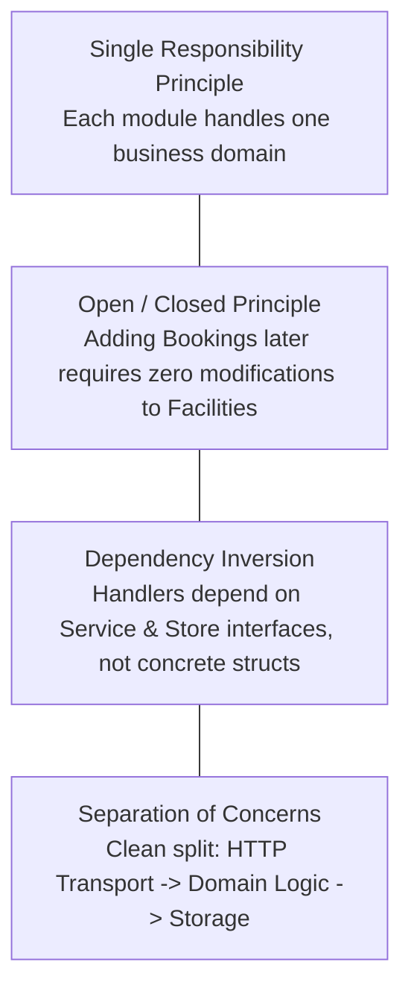
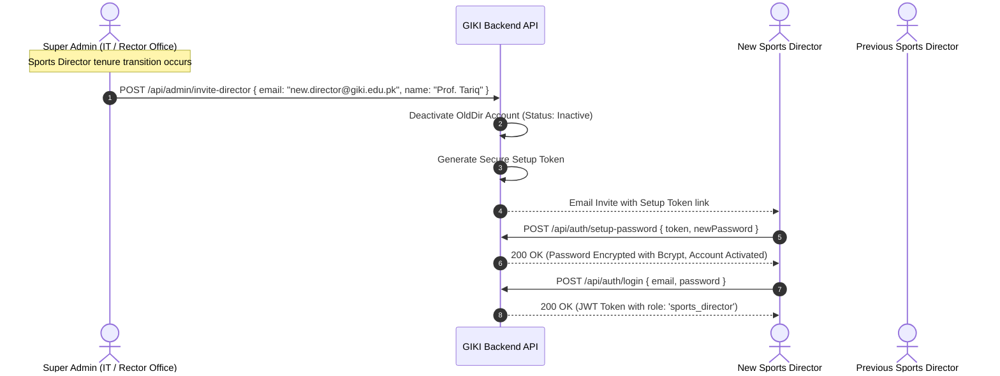
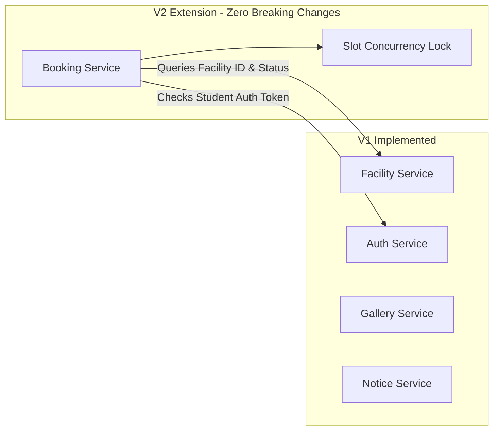

# GIKI Sports Complex — Modular Backend System Design Specification (V1)
**Document Version:** 2.0.0 (Modular Core Architecture)  
**Target Project:** GIKI Sports Complex Management System  
**Author / Architect:** Antigravity AI & Engineering Team  
**Date:** October 2026  
**Status:** Approved for Implementation  

---

## Table of Contents
1. [Executive Summary & V1 Objectives](#1-executive-summary--v1-objectives)
2. [Software Engineering Principles & Modular Strategy](#2-software-engineering-principles--modular-strategy)
3. [Identity & RBAC: Super Admin vs Sports Director](#3-identity--rbac-super-admin-vs-sports-director)
4. [Domain Modules & Entity Specifications](#4-domain-modules--entity-specifications)
   - [4.1 Facility & Timings Module (Padel, Pool, Basketball, Snooker, etc.)](#41-facility--timings-module)
   - [4.2 Student Achievements & Match Victories Module](#42-student-achievements--match-victories-module)
   - [4.3 Sports Complex Visual Gallery Module](#43-sports-complex-visual-gallery-module)
   - [4.4 Official Notices & Alerts Module](#44-official-notices--alerts-module)
5. [Pluggable Architecture: How Booking Integrates Later](#5-pluggable-architecture-how-booking-integrates-later)
6. [Complete REST API Contract (V1)](#6-complete-rest-api-contract-v1)
7. [Target Clean Architecture Package Layout in Go](#7-target-clean-architecture-package-layout-in-go)
8. [Database Schema (Relational SQL & JSON Data Store)](#8-database-schema-relational-sql--json-data-store)

---

## 1. Executive Summary & V1 Objectives

The **GIKI Sports Complex** digital platform is designed to modernize sports administration, facility timing announcements, and athletic honors for the Ghulam Ishaq Khan Institute of Engineering Sciences and Technology (GIKI).

### V1 Scope Focus:
Following the **Minimum Viable Product (MVP)** and **Separation of Concerns** principles, V1 intentionally defers slot reservation logic to deliver an ultra-reliable, modular foundation:
1. **Hierarchical Administration:** A **Super Admin** (IT / Campus Administration) manages the system and assigns/transfers the **Sports Director** account whenever personnel changes occur.
2. **Dynamic Facility Timings & Operational Status:** The Director can instantly adjust student timings, faculty-dedicated slots, and mark facilities as *Open*, *Under Maintenance*, or *Tournament Reserved*.
3. **Student Achievements & Match Victories Portal:** A dedicated showcase for university athletic victories (e.g. GIKI Cricket or Football team winning an intervarsity match or tournament gold).
4. **Campus Sports Photo Gallery:** High-resolution photo albums categorized by sport and tournament for public viewing.
5. **Campus Athletic Notices:** Fast, high-visibility bulletins for trials, weather alerts, or floodlight maintenance.

---

## 2. Software Engineering Principles & Modular Strategy

To ensure long-term maintainability and prevent technical debt, the backend adheres to four core software engineering tenets:



- **Open/Closed Principle:** The `Facility` entity has a clean identifier (`id`) and schedule that a future `BookingService` can query via an interface without touching existing handlers.
- **YAGNI (You Aren't Gonna Need It Yet):** Deferring complex state machines, payment gateways, and concurrency locks until the core information architecture and auth boundaries are rock solid.

---

## 3. Identity & RBAC: Super Admin vs Sports Director

### The Problem: Personnel Turnover
In academic institutions like GIKI, the role of Sports Director or faculty sports advisors periodically transitions between professors or administrative officers. 

### Best-Practice Solution: Two-Tier Administrative Hierarchy



### Role Permissions Matrix:

| Action / Capability | Anonymous Visitor | Sports Director | Super Admin |
|---|:---:|:---:|:---:|
| View Facility Timings & Status |  |  |  |
| View Match Achievements & Gallery |  |  |  |
| Read Notices & Alerts |  |  |  |
| Edit Facility Timings & Rules | ❌ |  |  |
| Upload Match Victories & Photos | ❌ |  |  |
| Broadcast Complex Notices | ❌ |  |  |
| Change Sports Director Email / Account | ❌ | ❌ |  |
| Reset Director Password / Revoke Access | ❌ | ❌ |  |
| System Backup & Configuration | ❌ | ❌ |  |

---

## 4. Domain Modules & Entity Specifications

### 4.1 Facility & Timings Module
Covers all 8 key facilities at GIKI:
1. **Glass Padel Courts (Court 1 & 2)**
2. **Semi-Olympic Swimming Pool**
3. **Teakwood Badminton Championship Hall**
4. **Glass-Back Squash Complex**
5. **Central Fitness & Strength Gym**
6. **Basketball Arena (Floodlit)**
7. **Snooker & Billiards Room**
8. **Table Tennis & Hard Tennis**

#### Facility Data Model:
```go
type Facility struct {
    ID             string    `json:"id"`             // e.g., "padel-court-1", "basketball-arena"
    Name           string    `json:"name"`           // "GIKI Basketball Arena"
    Category       string    `json:"category"`       // "Racquet", "Aquatics", "Indoor", "Outdoor", "Fitness"
    Status         string    `json:"status"`         // "open", "maintenance", "tournament_reserved", "closed"
    StudentTimings string    `json:"studentTimings"` // "06:00 AM - 11:00 AM & 04:00 PM - 10:30 PM"
    FacultyTimings string    `json:"facultyTimings"` // "05:00 PM - 07:00 PM (Dedicated Faculty Slot)"
    Location       string    `json:"location"`       // "Sports Complex East Wing"
    MaxCapacity    int       `json:"maxCapacity"`
    Rules          []string  `json:"rules"`          // ["Non-marking shoes mandatory", "Bring GIKI ID"]
    Image          string    `json:"image"`          // Cover image URL
    UpdatedAt      time.Time `json:"updatedAt"`
}
```

---

### 4.2 Student Achievements & Match Victories Module
Allows the Sports Director to celebrate students who won matches against outsider universities (LUMS, NUST, UET, IBA) or inter-batch galas.

#### Achievement Data Model:
```go
type Achievement struct {
    ID           string    `json:"id"`           // "ach-9821"
    Title        string    `json:"title"`        // "GIKI Cricket Team Defeats UET Peshawar in Inter-Varsity Derby"
    Sport        string    `json:"sport"`        // "Cricket", "Football", "Padel", "Badminton", "Basketball"
    Category     string    `json:"category"`     // "National Trophy", "Intervarsity Gold", "Bilateral Series"
    DateStr      string    `json:"dateStr"`      // "October 2026"
    Description  string    `json:"description"`  // Match summary, final overs scoreline, highlights
    OpponentTeam string    `json:"opponentTeam"` // "UET Peshawar", "LUMS Lahore", "Army Cadet College"
    ScoreSummary string    `json:"scoreSummary"` // "GIKI won by 4 wickets (Target: 178)"
    TeamMembers  string    `json:"teamMembers"`  // "Hamza Tariq (C), Daniyal Munir (WK), Saad Ali (54*)"
    Image        string    `json:"image"`        // Trophy presentation / match action photo
    DirectorNote string    `json:"directorNote"` // "Proud moment for GIKI Athletics! Outstanding grit shown."
    Featured     bool      `json:"featured"`     // Pin to top banner
    CreatedAt    time.Time `json:"createdAt"`
}
```

---

### 4.3 Sports Complex Visual Gallery Module
A responsive gallery for high-resolution athletic photography.

#### Gallery Data Model:
```go
type GalleryItem struct {
    ID          string    `json:"id"`
    Title       string    `json:"title"`       // "Annual All-Pakistan Badminton Championship"
    Category    string    `json:"category"`    // "Facilities", "Tournaments", "Night Sessions", "Gym"
    ImageURL    string    `json:"imageUrl"`
    Caption     string    `json:"caption"`
    TakenAt     string    `json:"takenAt"`     // "Fall 2026"
    CreatedAt   time.Time `json:"createdAt"`
}
```

---

### 4.4 Official Notices & Alerts Module
For real-time campus notices (e.g. pool filter cleaning, badminton trial dates).

#### Notice Data Model:
```go
type Notice struct {
    ID        string    `json:"id"`
    Title     string    `json:"title"`     // "Swimming Pool Closed for Ozone Filter Maintenance"
    Content   string    `json:"content"`   // "The pool will remain closed on Friday from 08:00 to 14:00."
    Priority  string    `json:"priority"`  // "urgent", "maintenance", "info"
    CreatedAt time.Time `json:"createdAt"`
}
```

---

## 5. Pluggable Architecture: How Booking Integrates Later

Because each domain is strictly isolated, adding the `booking` module later requires **no changes** to existing APIs or models:



The future `Booking` entity simply stores a `facility_id` reference:
```go
type Booking struct {
    ID         string `json:"id"`
    FacilityID string `json:"facilityId"` // Foreign key referencing Facility.ID
    Date       string `json:"date"`
    TimeSlot   string `json:"timeSlot"`
    BookerName string `json:"bookerName"`
    BookerID   string `json:"bookerId"`
    Status     string `json:"status"`
}
```

---

## 6. Complete REST API Contract (V1)

### Base URL: `/api`

### 1. Authentication & Admin Accounts
| Method | Route | Description | Auth Required |
|---|---|---|---|
| `POST` | `/auth/login` | Login with email/password; returns JWT | Public |
| `GET` | `/auth/me` | Returns current logged-in user profile & role | Bearer JWT |
| `POST` | `/admin/invite-director` | Assign/change Sports Director email | **Super Admin** |
| `POST` | `/auth/setup-password` | Complete invite and set password | Token Verification |

### 2. Facilities & Timings
| Method | Route | Description | Auth Required |
|---|---|---|---|
| `GET` | `/facilities` | List all 8 facilities, live timings, & statuses | Public |
| `GET` | `/facilities/:id` | Get single facility specs | Public |
| `PUT` | `/facilities/:id` | Update timings, rules, or status (Open/Maintenance) | **Director / Admin** |
| `POST` | `/facilities` | Add a new facility (e.g. Snooker / Basketball) | **Director / Admin** |

### 3. Student Achievements & Match Victories
| Method | Route | Description | Auth Required |
|---|---|---|---|
| `GET` | `/achievements` | List student tournament victories & matches | Public |
| `GET` | `/achievements/:id`| Get single achievement details | Public |
| `POST` | `/achievements` | Publish new match victory or trophy | **Director / Admin** |
| `DELETE` | `/achievements/:id`| Remove an achievement | **Director / Admin** |

### 4. Photo Gallery
| Method | Route | Description | Auth Required |
|---|---|---|---|
| `GET` | `/gallery` | Fetch photos (`?category=Tournaments`) | Public |
| `POST` | `/gallery` | Upload / add photo to gallery | **Director / Admin** |
| `DELETE` | `/gallery/:id` | Delete photo from gallery | **Director / Admin** |

### 5. Announcements / Notices
| Method | Route | Description | Auth Required |
|---|---|---|---|
| `GET` | `/notices` | List active notices | Public |
| `POST` | `/notices` | Broadcast urgent or maintenance alert | **Director / Admin** |
| `DELETE` | `/notices/:id` | Archive or delete notice | **Director / Admin** |

---

## 7. Target Clean Architecture Package Layout in Go

```text
backend/
├── cmd/
│   └── api/
│       └── main.go                 # Server setup, middleware, router wiring
├── internal/
│   ├── auth/                       # Super Admin & Director JWT authentication
│   │   ├── model.go                # AdminUser, Role
│   │   ├── service.go              # Password hashing (Bcrypt), JWT generation
│   │   ├── handler.go              # POST /auth/login, POST /admin/invite-director
│   │   └── middleware.go           # RequireAuth, RequireSuperAdmin, RequireDirector
│   ├── facility/                   # Facilities, Timings, Operational Status
│   │   ├── model.go                # Facility struct
│   │   ├── repository.go           # GetFacilities, UpdateFacilityTimings
│   │   └── handler.go              # GET /facilities, PUT /facilities/:id
│   ├── achievement/                # Student Match Victories & Trophies
│   │   ├── model.go                # Achievement struct
│   │   ├── repository.go           # List, Create, Delete
│   │   └── handler.go              # GET /achievements, POST /achievements
│   ├── gallery/                    # Campus Sports Visual Media
│   │   ├── model.go                # GalleryItem struct
│   │   ├── repository.go           # List, Create, Delete
│   │   └── handler.go              # GET /gallery, POST /gallery
│   ├── notice/                     # Urgent bulletins & trial alerts
│   │   ├── model.go                # Notice struct
│   │   └── handler.go              # GET /notices, POST /notices
│   └── booking/                    # ⏳ (Reserved for Phase 2 plug-in)
├── data/
│   └── store.json                  # Persistent atomic JSON storage
├── go.mod
└── go.sum
```

---

## 8. Database Schema (Relational SQL & JSON Data Store)

```sql
-- 1. Users & Administrative Roles
CREATE TABLE admin_users (
    id VARCHAR(36) PRIMARY KEY,
    name VARCHAR(100) NOT NULL,
    email VARCHAR(150) UNIQUE NOT NULL,
    password_hash VARCHAR(255) NOT NULL,
    role VARCHAR(30) NOT NULL CHECK (role IN ('super_admin', 'sports_director')),
    is_active BOOLEAN NOT NULL DEFAULT TRUE,
    created_at TIMESTAMP WITH TIME ZONE DEFAULT CURRENT_TIMESTAMP
);

-- 2. Facilities & Live Timings
CREATE TABLE facilities (
    id VARCHAR(64) PRIMARY KEY,
    name VARCHAR(255) NOT NULL,
    category VARCHAR(50) NOT NULL,
    status VARCHAR(30) NOT NULL DEFAULT 'open' CHECK (status IN ('open', 'maintenance', 'tournament_reserved', 'closed')),
    student_timings VARCHAR(255) NOT NULL,
    faculty_timings VARCHAR(255) NOT NULL,
    location VARCHAR(255) NOT NULL,
    max_capacity INT NOT NULL DEFAULT 4,
    rules JSONB NOT NULL DEFAULT '[]',
    image_url TEXT NOT NULL,
    updated_at TIMESTAMP WITH TIME ZONE DEFAULT CURRENT_TIMESTAMP
);

-- 3. Student Achievements & Match Victories
CREATE TABLE achievements (
    id VARCHAR(36) PRIMARY KEY,
    title VARCHAR(255) NOT NULL,
    sport VARCHAR(100) NOT NULL,
    category VARCHAR(50) NOT NULL,
    date_str VARCHAR(50) NOT NULL,
    description TEXT NOT NULL,
    opponent_team VARCHAR(150),
    score_summary VARCHAR(150),
    team_members TEXT NOT NULL,
    image_url TEXT NOT NULL,
    director_note TEXT,
    featured BOOLEAN NOT NULL DEFAULT FALSE,
    created_at TIMESTAMP WITH TIME ZONE DEFAULT CURRENT_TIMESTAMP
);

-- 4. Gallery Photos
CREATE TABLE gallery_items (
    id VARCHAR(36) PRIMARY KEY,
    title VARCHAR(255) NOT NULL,
    category VARCHAR(50) NOT NULL,
    image_url TEXT NOT NULL,
    caption TEXT,
    taken_at VARCHAR(50),
    created_at TIMESTAMP WITH TIME ZONE DEFAULT CURRENT_TIMESTAMP
);

-- 5. Notices & Announcements
CREATE TABLE notices (
    id VARCHAR(36) PRIMARY KEY,
    title VARCHAR(255) NOT NULL,
    content TEXT NOT NULL,
    priority VARCHAR(20) NOT NULL DEFAULT 'info' CHECK (priority IN ('urgent', 'maintenance', 'info')),
    created_at TIMESTAMP WITH TIME ZONE DEFAULT CURRENT_TIMESTAMP
);
```

---
*GIKI Sports Complex V1 Architecture Document — Modular, Scalable & Booking-Ready.*
